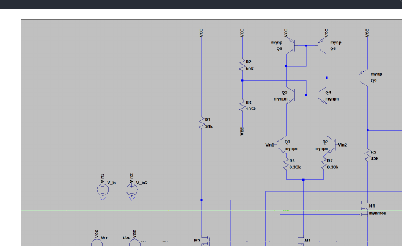
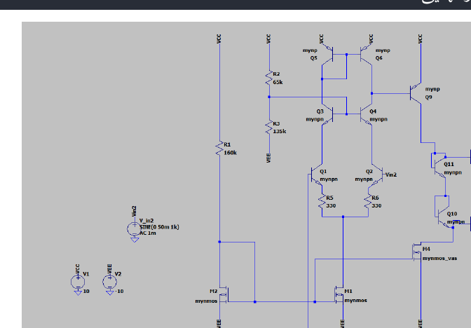

# Electronics II — Multistage Analog Amplifier
### From differential amplification to a Class-AB power output stage


## Overview

This repository contains a two-phase **Electronics II** project at **Sharif University of Technology**: the design and simulation of a **discrete, multistage analog amplifier** in **LTspice**.

The first phase focuses on a high-gain differential amplifier and its biasing circuitry. The second phase extends that design into a complete **closed-loop amplifier** with a **Class-AB push-pull output stage**, designed to drive a **50 Ω load** while controlling distortion and power consumption.

The core design question is:

> How can a high-gain, transistor-level amplifier be extended into a low-distortion, efficient output amplifier using bias stabilization and global negative feedback?

The repository preserves both submitted schematics and the corresponding reports, so that the design progression can be inspected independently.

---

## Project Structure

```text
Electronics-II-Multistage-Amplifier/
├── assets/
│   ├── phase-1-schematic.png
│   └── phase-2-schematic.png
├── phase-1/
│   ├── circuit/
│   │   └── Phase1_Amplifier.asc
│   └── report/
│       └── Phase1_Report.pdf
├── phase-2/
│   ├── circuit/
│   │   └── Phase2_Amplifier.asc
│   ├── audio/
│   │   ├── input.wav
│   │   └── output.wav
│   └── report/
│       └── Phase2_Report.pdf
├── project-specifications/
│   ├── Phase1_Assignment.pdf
│   └── Phase2_Assignment.pdf
├── scripts/
│   └── component_cost.py
├── docs/
│   └── GITHUB_SETUP.md
├── .gitattributes
├── .gitignore
└── README.md
```

---

## Phase I — Differential Amplifier Design

Phase I builds the amplifier's voltage-gain core using **discrete BJTs**, with **MOSFET current mirrors** for biasing. The submitted design includes:

- A **differential input pair** with active load circuitry.
- A **common-emitter voltage-amplification stage**.
- An **emitter-follower output buffer**.
- Current-mirror-based bias networks.



### Reported Phase I Results

| Metric | Assignment requirement | Reported result |
|---|---:|---:|
| Differential gain | > 54 dB | **81.4 dB** |
| Common-mode rejection ratio (CMRR) | > 80 dB | **85.7 dB** |
| Output swing | ≥ 6 Vpp | **8 Vpp** |
| Input resistance | > 50 kΩ | **175.4 kΩ** |
| Output resistance | < 5 kΩ | **285 Ω** |
| Quiescent power (without load) | < 60 mW | **43.6 mW** |
| Component cost | ≤ 200 units | **112 units** |

Phase I operates with **±10 V supplies** and a **500 Ω load** in the provided LTspice schematic.

**Files:** [LTspice schematic](phase-1/circuit/Phase1_Amplifier.asc) · [Phase I report](phase-1/report/Phase1_Report.pdf)

---

## Phase II — Closed-Loop Power Amplifier

Phase II integrates an output stage into the amplifier, followed by **global negative feedback** from the final output to the differential input.

The final architecture includes:

1. Differential input and current-mirror bias networks.
2. Voltage amplification and active load circuitry.
3. A **complementary Class-AB push-pull output stage**.
4. A two-resistor **negative-feedback network**.
5. A **50 Ω output load**.



The feedback network uses **Rf = 180 kΩ** and **Rg = 10 kΩ**. The nominal non-inverting feedback gain is approximately `1 + Rf/Rg = 19`, with an actual closed-loop gain of **18.67** reported at 1 kHz.

### Reported Phase II Results

| Metric | Assignment requirement | Reported result |
|---|---:|---:|
| Closed-loop voltage gain (1 kHz) | 18–22 | **18.67** |
| Undistorted output swing | ≥ 16 Vpp | **17.2 Vpp** |
| Output-stage efficiency | > 60% | **70.6%** |
| Total power at specified 50 mV, 1 kHz input | ≤ 190 mW | **187.6 mW** |
| THD (normal operation) | < 0.08% | **0.055%** |
| THD with noisy source | < 1% | **0.073%** |
| PSRR | Measured using 10 mV supply ripple | **133.22 dB** |
| Differential input resistance | > 1 MΩ | **11.86 MΩ** |
| Output resistance (without load) | < 50 Ω | **0.799 Ω** |
| Component cost | ≤ 200 units | **134 units** |

The Phase II circuit is powered by **±10 V**, and its current `.asc` file defines a **50 mV, 1 kHz sine-wave input** for transient analysis.

### What Changed Between Phases?

- The **500 Ω** evaluation load in Phase I is replaced by the **50 Ω** final load.
- A **Class-AB push-pull** output stage is added for load-driving capability.
- **Global negative feedback** controls the closed-loop gain and improves linearity.
- Bias and gain-stage component values are revised to accommodate the integrated output stage.
- Audio-file testing and waveform, THD, PSRR, resistance and efficiency measurements are documented in the Phase II report.

**Files:** [LTspice schematic](phase-2/circuit/Phase2_Amplifier.asc) · [Phase II report](phase-2/report/Phase2_Report.pdf)

---

## Audio Demonstration

The Phase II materials include an audio input sample and a saved output waveform:

- [`input.wav`](phase-2/audio/input.wav) — input audio sample.
- [`output.wav`](phase-2/audio/output.wav) — supplied audio output artifact.

**Reproduction note:** The preserved Phase II `.asc` uses a `SINE(...)` input source, **not a WAV playback source**. The audio files are provided as accompanying project artifacts. To repeat an audio simulation, configure an LTspice WAV-compatible input and output workflow separately; it is not enabled automatically by opening the archived schematic.

---

## Opening and Inspecting the Project

1. Install **LTspice** on your computer.
2. Open `phase-1/circuit/Phase1_Amplifier.asc` to inspect Phase I. The source file contains a `.op` operating-point directive.
3. Open `phase-2/circuit/Phase2_Amplifier.asc` for the complete closed-loop design. The supplied source includes `.tran 5ms`, `.FOUR` and `.meas` directives.
4. Click **Run** inside LTspice. Use the simulation log to inspect numerical results and click the output node to see its waveform.
5. Consult the PDFs in `phase-1/report/`, `phase-2/report/` and `project-specifications/` for the original derivations, plots and acceptance criteria.

The design uses custom transistor model statements embedded directly in the LTspice schematics, including 2N3904/2N3906-based BJT models and custom NMOS models. No Python packages are needed for the LTspice schematics.

> **Results provenance:** All metrics in the tables above are **transcribed from the submitted PDF reports**, not from a new LTspice run. The original circuit files have been preserved without changing their electrical content. Some report experiments use different source/analysis configurations than the archived main `.asc`; reproduce those tests by following the PDFs.

### Checking Component Cost

The included Python 3 utility counts the components in the original LTspice schematics:

```bash
python scripts/component_cost.py
```

The cost model comes from the assignment: **BJT = 5**, **MOSFET = 3**, **resistor = 10**, **capacitor = 40** units. The default calculation **excludes the external `R_L` load**, matching the report totals of **112** (Phase I) and **134** (Phase II). Pass `--include-load` to count the load resistor too.

---

## Tools and Concepts

- **LTspice** — transistor-level schematic capture and simulation.
- **BJT differential amplifiers** and **common-emitter gain stages**.
- **MOSFET current mirrors**, active loads and bias stabilization.
- **Class-AB complementary push-pull** output stages.
- **Global negative feedback** and closed-loop gain control.
- **Transient, DC operating-point, harmonic-distortion and PSRR analyses**.
- **Python 3** — optional component-cost utility.

---

## Reports and Project Briefs

| Document | File |
|---|---|
| Phase I assignment | [Phase1_Assignment.pdf](project-specifications/Phase1_Assignment.pdf) |
| Phase II assignment | [Phase2_Assignment.pdf](project-specifications/Phase2_Assignment.pdf) |
| Phase I design and simulation report | [Phase1_Report.pdf](phase-1/report/Phase1_Report.pdf) |
| Phase II design and evaluation report | [Phase2_Report.pdf](phase-2/report/Phase2_Report.pdf) |

---

## Key Takeaway

The first phase establishes a high-gain, high-CMRR voltage amplifier. The second phase demonstrates how **power-stage biasing** and **feedback around the complete transistor-level circuit** can provide load-driving capability with low distortion while retaining an explicitly controlled closed-loop gain.

> A practical analog amplifier requires more than high voltage gain: output drive, biasing, linearity, efficiency and feedback must be designed together.

---

## Author

**AmirAli Jahanbakhshi** — [@AmirAli-jb](https://github.com/AmirAli-jb)

Electronics II · Sharif University of Technology

*This repository documents a course design and its simulation results; it does not claim that a physical amplifier was constructed and bench-tested.*
